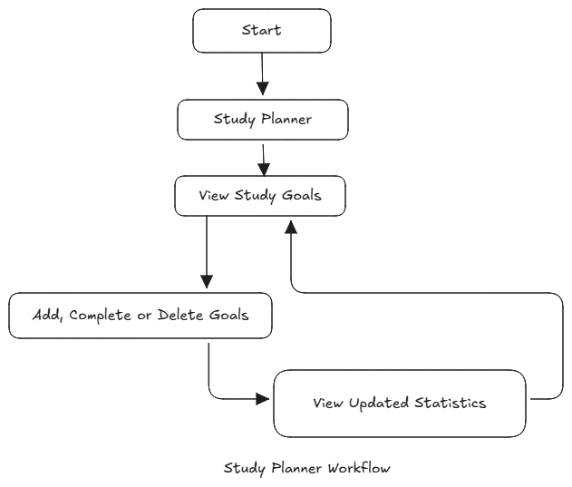
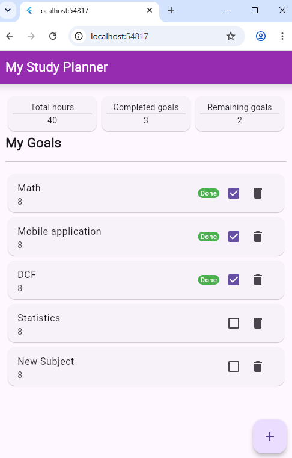
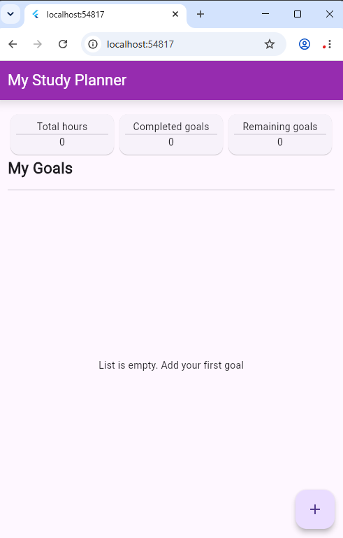

# My Study Planner

A Flutter mobile application designed to help students organize their study goals, track completed tasks, and monitor their study progress.

Developed as part of the **Mobile App Development (Dart & Flutter)** course at UNILAK.

**Group 2**

RegNo:
 - 26919/2024
 - 26288/2024
 - 25967/2024
 - 27058/2024
 - 26626/2024


## Technologies Used

- Flutter
- Dart

## Application Flow

The diagram below shows the basic workflow of the Study Planner.




## Getting Started

### Prerequisites

- Flutter SDK
- Dart
- Android Studio or VS Code
- Android emulator or physical device
- Git

### Installation

**1. Clone the repository**

```bash
git clone https://github.com/faustine-van/study_planner.git
```

**2. Navigate to the project directory**

```bash
cd study_planner
```

**3. Install dependencies**

```bash
flutter pub get
```

**4. Run the application**

Run on the default available device:

```bash
flutter run
```

Or run in Google Chrome:

```bash
flutter run -d chrome
```

**Note:** Make sure your emulator or physical device is connected and available before running the default command.

## Project Progress

### Phase 1: Static Screen

**Status: Completed**

Implemented the initial user interface using Flutter Material widgets.

**Features implemented:**

- AppBar displaying "My Study Planner".
- Heading displaying "My List".
- Three or more static study goal cards.
- Subject names and planned study hours.
- Card and ListTile widgets.
- FloatingActionButton (functionality added in Phase 2).
- StatelessWidget for the initial home screen.

**Deliverables:**

- [x] Application runs successfully.
- [x] Static study goal screen implemented.
- [x] Screenshot of the running application.
- [x] `lib/main.dart`

**Phase 1 Screenshot**


---

### Phase 2: Working List

**Status: Completed**

Converted the static screen into a functional study planner using StatefulWidget and setState().

**Features implemented:**

- Study goals stored in a List of Maps.
- Dynamic display of goals using ListView.builder.
- Add a sample study goal using the FloatingActionButton.
- Mark goals as completed or incomplete using a Checkbox.
- Visual distinction between completed and incomplete goals.
- Delete study goals using the delete icon.
- Update the interface dynamically using setState().

**Deliverables:**

- [x] Add new samples study goals.
- [x] Mark goals as completed or incomplete.
- [x] Delete study goals.
- [x] Display goals dynamically from a list.
- [x] `lib/main.dart`

**Phase 1 Screenshot**


---

### Phase 3: Statistics & Summary Cards

**Status: Completed**

Added summary statistics to help users monitor their study progress.

**Features implemented:**
- Total study hours calculated using `fold()`.
- Completed and remaining goals counted using `where()`.
- Reusable `CardStatistics` StatelessWidget.
- Three equally sized summary cards using `Row` and `Expanded`.
- Empty-state message when there are no study goals.
- Statistics update automatically when goals are added, completed, or deleted.

**Screenshots**

**Statistics and Study Goals**



**Empty State**



**Deliverables:**
- Working summary cards.
- Correct statistics calculations.
- Reusable statistics widget.
- Dynamic statistics updates.
- Empty-state display.
- Updated `main.dart`.


### Phase 4: Add Goal Screen

**Status:** Completed

This phase introduces a separate screen for adding study goals.

**Features implemented:**
- Added a dedicated `AddGoalScreen`.
- Added input fields for the subject and study hours.
- Implemented form validation to ensure the subject is not empty and the hours are a valid number greater than zero.
- Used `TextEditingController` to manage form input.
- Used `Navigator.push()` to open the Add Goal screen.
- Used `Navigator.pop()` to return the new goal to the home screen.
- Updated the goals list and statistics after a goal is added.
- Disposed of the text controllers and focus nodes.

**Screenshots:**

| Add Goal Screen | Form Validation |
|---|---|
|  |  |

| Updated Goals List |
|---|
|  |


## Project Structure

```text
study_planner/
├── android/
├── ios/
├── lib/
│   └── main.dart
├── test/
├── screenshots/
│   ├── Phase1.PNG
│   ├── Phase2.PNG
│   ├── Phase3.png
│   ├── Phase3 - empty list.png
│   └── workflow.png
├── .gitignore
├── README.md
├── pubspec.yaml
└── pubspec.lock
```


## Project Status

| Phase | Description | Status |
|---|---|---|
| 1 | Static Screen | Completed |
| 2 | Working List | Completed |
| 3 | Statistics & Cards | Not Started |
| 4 | Second Screen | Not Started |
| 5 | Database Persistence | Not Started |

Development is progressing phase by phase.