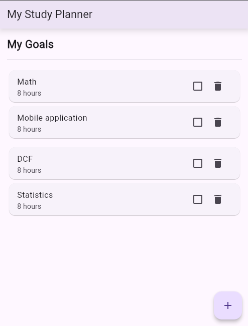
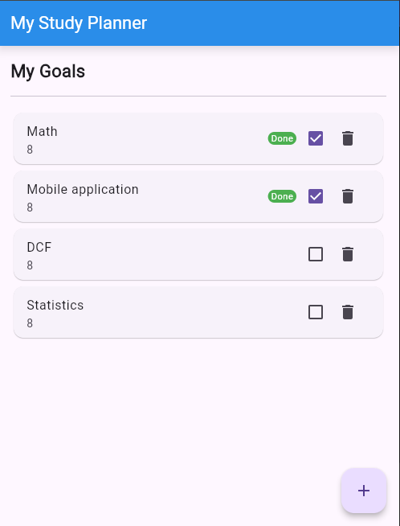

# My Study Planner

A Flutter mobile application designed to help students organize their study goals, track completed tasks, and monitor their study progress.

Developed as part of the **Mobile App Development (Dart & Flutter)** course at UNILAK.

## Technologies Used

- Flutter
- Dart

## Getting Started

### Prerequisites

- Flutter SDK
- Dart SDK
- Android Studio or VS Code
- Android emulator or physical device
- Git

### Installation

**1. Clone the repository**

```bash
git clone https://github.com/faustine-van/study_planner.git
```

**2. Navigate to the project directory**

```bash
cd study_planner
```

**3. Install dependencies**

```bash
flutter pub get
```

**4. Run the application**

Run on the default available device:

```bash
flutter run
```

Or run in Google Chrome:

```bash
flutter run -d chrome
```

**Note:** Make sure your emulator or physical device is connected and available before running the default command.

## Project Progress

### Phase 1: Static Screen

**Status: Completed**

Implemented the initial user interface using Flutter Material widgets.

**Features implemented:**

- AppBar displaying "My Study Planner".
- Heading displaying "My List".
- Three or more static study goal cards.
- Subject names and planned study hours.
- Card and ListTile widgets.
- FloatingActionButton (functionality added in Phase 2).
- StatelessWidget for the initial home screen.

**Deliverables:**

- [x] Application runs successfully.
- [x] Static study goal screen implemented.
- [x] Screenshot of the running application.
- [x] `lib/main.dart`

**Phase 1 Screenshot**



---

### Phase 2: Working List

**Status: Completed**

Converted the static screen into a functional study planner using StatefulWidget and setState().

**Features implemented:**

- Study goals stored in a List of Maps.
- Dynamic display of goals using ListView.builder.
- Add a sample study goal using the FloatingActionButton.
- Mark goals as completed or incomplete using a Checkbox.
- Visual distinction between completed and incomplete goals.
- Delete study goals using the delete icon.
- Update the interface dynamically using setState().

**Deliverables:**

- [x] Add new samples study goals.
- [x] Mark goals as completed or incomplete.
- [x] Delete study goals.
- [x] Display goals dynamically from a list.
- [x] `lib/main.dart`

**Phase 1 Screenshot**




---

### Phase 3: Statistics & Cards

**Status: Completed**

Added a summary section to the top of the Study Planner to give students an overview of their study progress.

**Features implemented:**

- Three summary cards: Total hours, Completed goals, and Remaining goals.
- Calculate total study hours using `fold()`.
- Count completed and remaining goals using `where()`.
- Use getters to calculate statistics in the logic section.
- Create a reusable `StatelessWidget` for the summary cards.
- Display the three cards in a Row using Expanded.
- Update statistics automatically when study goals change.
- Display a friendly message when there are no study goals.

**Deliverables:**

- [x] Total study hours calculated correctly.
- [x] Completed goals counted correctly.
- [x] Remaining goals counted correctly.
- [x] Statistics update when goals change.
- [x] Reusable summary card widget implemented.
- [x] `lib/main.dart`


## Project Structure

```text
study_planner/
├── lib/
│   └── main.dart
├── screenshots/
│   ├── Phase1.PNG
│   └── phase-2/
├── docs/
│   └── PHASE_CHECKLIST.md
├── android/
├── ios/
├── test/
├── README.md
├── pubspec.yaml
└── .gitignore
```

## Project Status

| Phase | Description | Status |
|---|---|---|
| 1 | Static Screen | Completed |
| 2 | Working List | Completed |
| 3 | Statistics & Cards | Not Started |
| 4 | Second Screen | Not Started |
| 5 | Database Persistence | Not Started |

Development is progressing phase by phase.