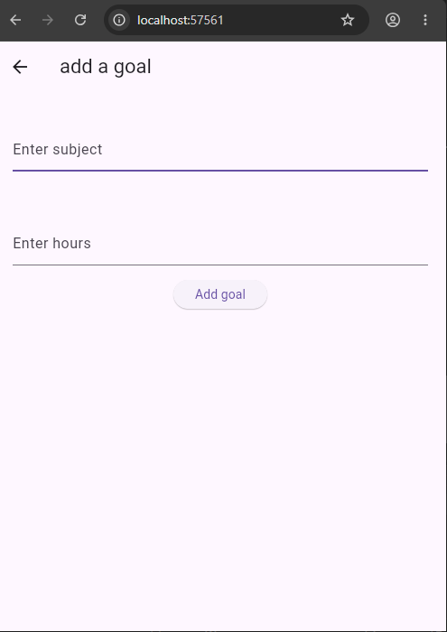
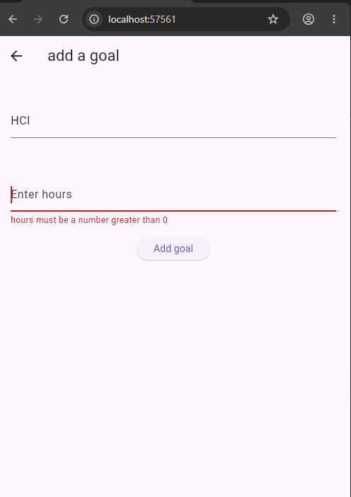
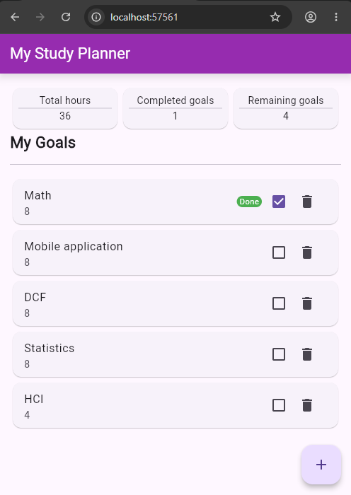
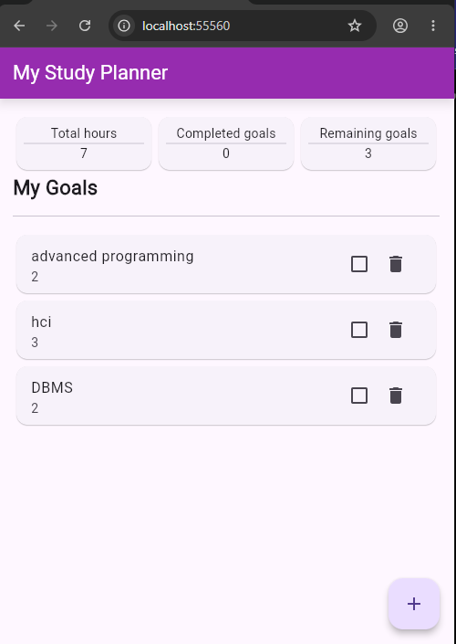

# My Study Planner

A Flutter mobile application designed to help students organize their study goals, track completed tasks, and monitor their study progress.

Developed as part of the **Mobile App Development (Dart & Flutter)** course at UNILAK.

**Group 2**

**Registration Numbers:**
- 26919/2024
- 26288/2024
- 25967/2024
- 27058/2024
- 26626/2024

## Technologies Used

- Flutter
- Dart
- Firebase Core
- Cloud Firestore

## Application Flow

The diagram below shows the basic workflow of the Study Planner.


## Getting Started

### Prerequisites

- Flutter SDK
- Dart
- Android Studio or VS Code
- Android emulator or physical device
- Git
- Firebase project configuration

### Installation

**1. Clone the repository**

```bash
git clone https://github.com/faustine-van/study_planner.git
```

**2. Navigate to the project directory**

```bash
cd study_planner
```

**3. Install dependencies**

```bash
flutter pub get
```

**4. Configure Firebase**

The project uses Firebase Core and Cloud Firestore.

Make sure the Firebase configuration file (`firebase_options.dart`) is available in the project.

The Firebase project must also have Cloud Firestore enabled.

**5. Run the application**

Run on the default available device:

```bash
flutter run
```

Or run in Google Chrome:

```bash
flutter run -d chrome
```

**Note:** Make sure your emulator or physical device is connected and available before running the default command.

---

## Project Progress

### Phase 1: Static Screen

**Status: Completed**

Implemented the initial user interface using Flutter Material widgets.

**Features implemented:**

- AppBar displaying "My Study Planner".
- Heading displaying "My Goals".
- Three or more static study goal cards.
- Subject names and planned study hours.
- Card and ListTile widgets.
- FloatingActionButton (functionality added in Phase 2).
- StatelessWidget for the initial home screen.

**Deliverables:**

- [x] Application runs successfully.
- [x] Static study goal screen implemented.
- [x] Screenshot of the running application.
- [x] `lib/main.dart`

**Phase 1 Screenshot**


---

### Phase 2: Working List

**Status: Completed**

Converted the static screen into a functional study planner using StatefulWidget and setState().

**Features implemented:**

- Study goals stored in a List of Maps.
- Dynamic display of goals using ListView.builder.
- Add a sample study goal using the FloatingActionButton.
- Mark goals as completed or incomplete using a Checkbox.
- Visual distinction between completed and incomplete goals.
- Delete study goals using the delete icon.
- Update the interface dynamically using setState().

**Deliverables:**

- [x] Add new sample study goals.
- [x] Mark goals as completed or incomplete.
- [x] Delete study goals.
- [x] Display goals dynamically from a list.
- [x] `lib/main.dart`

**Phase 2 Screenshot**


---

### Phase 3: Statistics & Summary Cards

**Status: Completed**

Added summary statistics to help users monitor their study progress.

**Features implemented:**

- Total study hours calculated using `fold()`.
- Completed and remaining goals counted using `where()`.
- Reusable `CardStatistics` StatelessWidget.
- Three equally sized summary cards using `Row` and `Expanded`.
- Empty-state message when there are no study goals.
- Statistics update automatically when goals are added, completed, or deleted.

**Screenshots**

**Statistics and Study Goals**


**Empty State**


**Deliverables:**

- [x] Working summary cards.
- [x] Correct statistics calculations.
- [x] Reusable statistics widget.
- [x] Dynamic statistics updates.
- [x] Empty-state display.
- [x] Updated `main.dart`.

---

### Phase 4: Add Goal Screen

**Status: Completed**

Introduced a separate screen for adding study goals.

**Features implemented:**

- Added a dedicated `AddGoalScreen`.
- Added input fields for the subject and study hours.
- Implemented form validation to ensure the subject is not empty and the hours are a valid number greater than zero.
- Used `TextEditingController` to manage form input.
- Used `Navigator.push()` to open the Add Goal screen.
- Used `Navigator.pop()` to return the new goal to the home screen.
- Updated the goals list and statistics after a goal is added.
- Disposed of the text controllers and focus nodes.

**Screenshots**

| Add Goal Screen | Form Validation |
|---|---|
|  |  |

**Updated Goals List**



---

### Phase 5: Firebase & Database Persistence

**Status: Completed**

Integrated Firebase Cloud Firestore to store study goals persistently instead of keeping them only in the application's memory.

Goals are saved in the cloud and retrieved when the application opens, allowing them to remain available after closing and reopening the app.

**Technologies introduced:**

- Firebase Core: Initializes Firebase in the Flutter application.
- Cloud Firestore: Stores and manages study goals in the cloud.

**Features implemented:**

- Integrated Firebase into the Flutter project.
- Configured Firebase using `firebase_options.dart`.
- Initialized Firebase before running the application.
- Created a separate `database_helper.dart` file to handle database operations.
- Implemented `insertGoal()` to save new goals to Firestore.
- Implemented `getGoals()` to retrieve saved goals from Firestore.
- Implemented `updateGoal()` to update the completion status of a goal.
- Implemented `deleteGoal()` to remove a goal from Firestore.
- Used Firestore document IDs to identify individual goals.
- Used `initState()` to load saved goals when the home screen initializes.
- Used `async` and `await` to handle database operations.
- Added a loading indicator while retrieving goals.
- Reloaded the goals list after adding, updating, or deleting a goal.
- Preserved the statistics functionality from Phase 3.

**Database Structure**

Firestore collection: `goals`

| Field | Data Type | Description |
|---|---|---|
| id | String (document ID) | Unique Firestore document identifier |
| subject | String | Name of the study subject |
| hours | Number | Planned study hours |
| done | Boolean | Completion status |

**Database Operations**

| Function | Description |
|---|---|
| `initializeFirebase()` | Initializes Firebase before the application starts |
| `insertGoal()` | Adds a new goal to Firestore |
| `getGoals()` | Retrieves all saved goals |
| `updateGoal()` | Updates the completion status of a goal |
| `deleteGoal()` | Deletes a goal using its document ID |

**Data Retrieval Approach**

The application uses one-time data fetching with Firestore's `.get()` method rather than real-time listeners.

After a database operation, `loadGoals()` retrieves the latest data and updates the interface using `setState()`.

**Deliverables:**

- [x] Firebase successfully integrated.
- [x] Goals saved to Firestore.
- [x] Goals retrieved when the application opens.
- [x] Completion status updated in Firestore.
- [x] Goals deleted from Firestore.
- [x] Data persists after restarting the application.
- [x] Database operations separated into `database_helper.dart`.
- [x] Statistics preserved after retrieving goals.

**Phase 5 Screenshot**



---

## Project Structure

```text
study_planner/
├── android/
├── ios/
├── lib/
│   ├── main.dart
│   ├── add_goal_screen.dart
│   ├── database_helper.dart
│   └── firebase_options.dart
├── screenshots/
│   ├── Phase1.PNG
│   ├── Phase2.PNG
│   ├── Phase3.png
│   ├── Phase3_empty_list.png
│   ├── add-goal-screen.PNG
│   ├── add-goal-validation.PNG
│   ├── updated-goals-list.PNG
│   └── workflow.png
├── test/
├── .gitignore
├── README.md
├── pubspec.yaml
└── pubspec.lock
```

## Project Status

| Phase | Description | Status |
|---|---|---|
| 1 | Static Screen | Completed |
| 2 | Working List | Completed |
| 3 | Statistics & Cards | Completed |
| 4 | Add Goal Screen | Completed |
| 5 | Firebase & Database Persistence | Completed |

Development progressed phase by phase, introducing Flutter UI development, state management, navigation, form validation, and Firebase database integration.